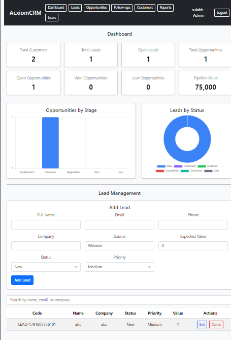
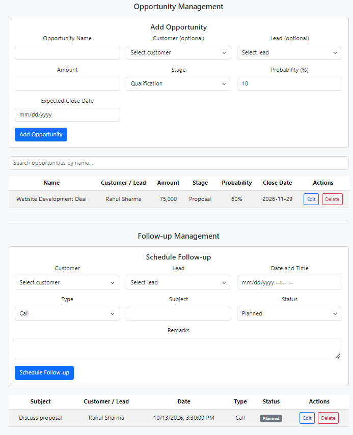
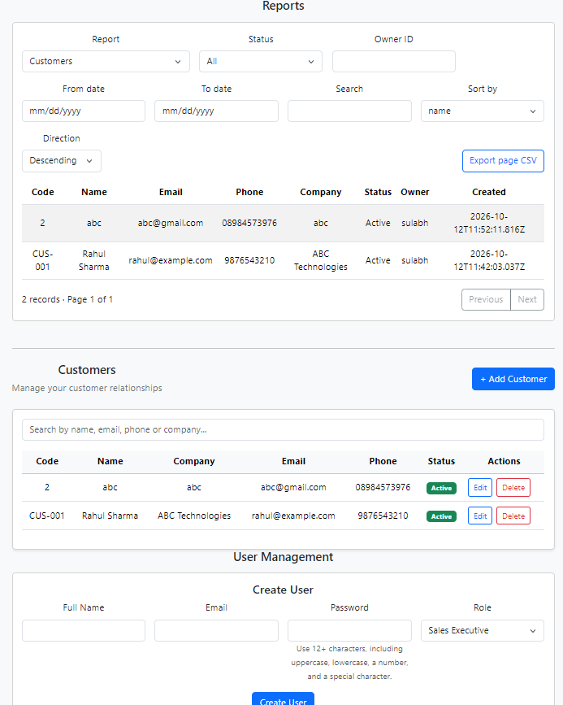

# AcxiomCRM

AcxiomCRM is a browser-based customer relationship management application for
tracking customers, sales leads, opportunities, follow-ups, and user activity.
It provides a role-aware React interface backed by an Express REST API and
PostgreSQL.

## Screenshots

### Dashboard and Lead Management


### Opportunity and Follow-up Management


### Reports and User Management


## Project objectives

- Maintain customer, lead, opportunity, and follow-up records in one CRM.
- Support role-aware access for Admin, Manager, and Sales Executive users.
- Provide sales pipeline and activity summaries, reports, and audit visibility.
- Validate input on the server and record important actions in audit logs.

## Features currently implemented

- JWT login, authenticated `/me`, logout token revocation, failed-login
  lockout, and login request throttling.
- Admin-managed user creation and activation/deactivation.
- Customer create/read/update/delete and search.
- Lead create/read/update/delete, search, and qualified-lead conversion.
  Conversion creates linked records transactionally and is safe to retry.
- Opportunity and follow-up management, including validation of amounts,
  probabilities, links, statuses, and dates.
- Dashboard KPIs and stage/status summaries. Sales Executives are scoped to
  their own assigned records in its queries.
- Customer, lead, follow-up, opportunity, pipeline, conversion, user activity,
  and audit reports. Reports provide server-side filtering and pagination;
  the UI exports the **current report page** to CSV.
- Helmet security headers, parameterized PostgreSQL queries, PostgreSQL TLS
  certificate verification by default, and configurable frontend API origin.

This list describes implementation present in the source; it is not a claim
that every feature has passed a live database or browser acceptance test.

## Technology stack

| Area | Implementation |
| --- | --- |
| Frontend | React 19, Vite 8, JavaScript/JSX, Bootstrap 5 |
| Charts | Chart.js 4 and `react-chartjs-2` |
| HTTP client | Axios |
| Backend | Node.js, Express 5 |
| Database | PostgreSQL, accessed through `pg` and parameterized SQL |
| Validation/security | Zod, bcrypt, JSON Web Tokens, Helmet, `express-rate-limit` |
| Backend tests | Node.js built-in test runner (`node:test`) |

The repository does not contain an ASP.NET Core, EF Core, or Razor/MVC
application.

## Architecture and project structure

```text
.
├── backend/
│   ├── middleware/       # Authentication and role authorization
│   ├── migrations/       # Incremental schema migrations (001 and 002)
│   ├── routes/           # Express REST API route modules
│   ├── scripts/          # Initial Admin creation utility
│   ├── test/             # Mock-backed API tests
│   ├── db.js             # PostgreSQL connection pool/TLS configuration
│   ├── package.json
│   └── server.js         # API entry point
└── frontend/
    ├── public/           # Static assets
    ├── src/              # React app, pages, API client, and styles
    ├── package.json
    └── vite.config.js
```

The frontend calls the API under `/api` using the configured base URL. The
Express server mounts route modules under `/api/auth`, `/api/customers`,
`/api/dashboard`, `/api/leads`, `/api/opportunities`, `/api/followups`,
`/api/users`, and `/api/reports`.

## Prerequisites

- Node.js and npm. The project was last validated in this workspace with
  Node.js 24 and npm 12; use a Node version compatible with the installed Vite
  release.
- A reachable PostgreSQL database with the **existing AcxiomCRM base schema**
  required by the API.
- `psql` if applying the included SQL migration files from the command line.
- Two terminals for running the frontend and backend concurrently.

## Installation and local configuration

Install dependencies separately in each application directory:

```powershell
cd backend
npm ci
```

In a second terminal, from the repository root:

```powershell
cd frontend
npm ci
```

### Environment variables

Create `backend/.env` locally; no `.env.example` is currently provided. Do not
commit it or paste real credentials into documentation, source control,
screenshots, or support requests. The current checkout has no root
`.gitignore`, so check `git status --short` before staging files and never stage
the local environment file.

```dotenv
DATABASE_URL=<postgresql-connection-uri>
JWT_SECRET=<long-random-secret>
PORT=3001
```

| Variable | Required | Purpose |
| --- | --- | --- |
| `DATABASE_URL` | Yes | PostgreSQL connection URI read by `backend/db.js`. |
| `JWT_SECRET` | Yes | Secret used to sign and verify bearer tokens. Use a unique, high-entropy value and keep it private. |
| `PORT` | No | API listening port; defaults to `3001`. |
| `NODE_ENV` | No | Set to `production` for production behavior. Production database TLS verification cannot be disabled by `DATABASE_SSL=false`. |
| `DATABASE_SSL` | No | Set to `false` only for a local/non-production PostgreSQL server that does not support TLS. Otherwise certificate verification is enabled. |
| `VITE_API_BASE_URL` | No | Frontend API base URL; defaults to `http://127.0.0.1:3001/api`. Set in `frontend/.env.local` when needed. |

For example, a local-only frontend setting can be placed in
`frontend/.env.local`:

```dotenv
VITE_API_BASE_URL=http://127.0.0.1:3001/api
```

Do not put `JWT_SECRET` or database credentials in any `VITE_*` variable:
Vite variables are exposed to browser code.

## Database setup and migrations

**Important:** The repository does not include a complete baseline schema
creation script or a migration runner. Migrations 001 and 002 are incremental
and require the existing `users`, `leads`, `customers`, and `opportunities`
tables (as well as the rest of the application's expected CRM schema) to
already exist. A blank PostgreSQL database cannot be initialized from these
two migrations alone. Obtain or provision the approved base schema before
continuing.

The current implementation requires both migrations:

1. `backend/migrations/001_add_user_token_version.up.sql` adds
   `users.token_version`, used by login, authenticated requests, logout, and
   user deactivation to revoke tokens.
2. `backend/migrations/002_add_lead_conversion_references.up.sql` adds
   foreign-key references from leads to converted customer/opportunity
   records and uniqueness constraints, used by transactional lead conversion.

Apply them only to a database positively confirmed to be a **development or
test** database. `psql` does not load `backend/.env` automatically; set
`DATABASE_URL` in the current terminal using your secure local secret
handling. Before applying:

1. Confirm the selected database/host with the database owner; do not infer
   that a database is non-production from its name.
2. Take an appropriate backup and confirm the expected base tables exist.
3. Check whether each migration has already been applied. The repository does
   not track migration history or automatically skip existing changes.
4. Apply in order from `backend/`, stopping on the first error:

```powershell
psql "$env:DATABASE_URL" -v ON_ERROR_STOP=1 -f .\migrations\001_add_user_token_version.up.sql
psql "$env:DATABASE_URL" -v ON_ERROR_STOP=1 -f .\migrations\002_add_lead_conversion_references.up.sql
```

These commands are provided as instructions only; this README-writing task
does not run them. Do not apply the files blindly to a production database.
The corresponding `.down.sql` files remove the added columns; use them only
as a deliberate rollback after assessing their effects and under an approved
backup/recovery plan.

## Create the initial Admin account

After PostgreSQL is configured, the complete base schema exists, and the two
required migrations have been applied where needed, run the interactive
utility from `backend/`:

```powershell
node scripts/createAdmin.js
```

It prompts for a name, email, and password, hashes the password with bcrypt,
and inserts the account with the `Admin` role. The password must be 12–128
characters and include lowercase, uppercase, numeric, and special characters.
Use a private terminal and do not put the password in a command-line argument
or save it in this README. The utility is not a general database initializer;
it requires the `users` table and its expected columns to be present. It does
not create a default account or seed CRM records.

## Run locally

Start the API in one terminal:

```powershell
cd backend
node server.js
```

The server binds to `127.0.0.1` and defaults to port `3001`. Start the Vite
development server in another terminal:

```powershell
cd frontend
npm run dev
```

Open the local URL printed by Vite (normally `http://localhost:5173`). The
backend CORS configuration currently allows `localhost:5173` and
`127.0.0.1:5173`. The health endpoint, `GET /api/health`, checks database
connectivity on port `3001`.

There is no backend `start` or `dev` npm script in `backend/package.json`; run
`node server.js` as shown. `nodemon` is installed as a dependency but is not
configured as a package script.

## API endpoints

All paths below are relative to `http://127.0.0.1:3001`. Except for login and
health, endpoints require an active user and an `Authorization` bearer header
containing the token returned by login. Treat that token as a secret.

| Method | Path | Access / purpose |
| --- | --- | --- |
| `POST` | `/api/auth/login` | Public; validates credentials and issues a one-hour JWT. Login requests are rate limited. |
| `POST` | `/api/auth/logout` | Authenticated; increments the user's token version, invalidating all that user's outstanding tokens, and records a logout event. |
| `GET` | `/api/auth/me` | Authenticated; returns the current active user's profile. |
| `GET` | `/api/health` | Public; performs a database connectivity check. |
| `GET`, `POST` | `/api/customers` | Authenticated list/search and create. |
| `GET`, `PUT`, `DELETE` | `/api/customers/:id` | Read/update; deletion is Admin/Manager-only. |
| `GET`, `POST` | `/api/leads` | Authenticated list/search and create. |
| `GET`, `PUT`, `DELETE` | `/api/leads/:id` | Read/update; deletion is Admin/Manager-only. |
| `POST` | `/api/leads/:id/convert` | Authenticated; converts a Qualified lead and creates its linked customer, with an optional opportunity. A repeated request does not recreate linked records. |
| `GET`, `POST` | `/api/opportunities` | Authenticated list/search and create. |
| `GET`, `PUT`, `DELETE` | `/api/opportunities/:id` | Read/update; deletion is Admin/Manager-only. |
| `GET`, `POST` | `/api/followups` | Authenticated list and create. |
| `GET`, `PUT`, `DELETE` | `/api/followups/:id` | Read/update; deletion is Admin/Manager-only. |
| `GET` | `/api/dashboard` | Authenticated KPI and stage/status summary. |
| `GET`, `POST` | `/api/users` | Admin-only list and create users. |
| `PATCH` | `/api/users/:id/status` | Admin-only activate/deactivate. |
| `GET` | `/api/reports/customers` | Authenticated customer report. |
| `GET` | `/api/reports/leads` | Authenticated lead report. |
| `GET` | `/api/reports/followups` | Authenticated follow-up report, including optional overdue filter. |
| `GET` | `/api/reports/opportunity-details` | Authenticated opportunity detail report. |
| `GET` | `/api/reports/opportunities` | Authenticated stage/owner pipeline summary. |
| `GET` | `/api/reports/conversions` | Authenticated lead conversion summary. |
| `GET` | `/api/reports/user-activity` | Admin-only aggregated user activity report. |
| `GET` | `/api/reports/audit-logs` | Admin-only audit report. |

Reports support pagination (`page`, `limit`, capped at 100 rows per page) and
applicable filters such as `from_date`, `to_date`, `owner_id`, `status`,
`stage`, `source`, `search`, `overdue`, `user_id`, `action`, and
`entity_name`. Sorting is available on endpoints that accept `sort` and
`direction`; allowed sort fields are selected server-side. Invalid dates and
enumerated filters return a client error. Consult the route implementation
before relying on a particular filter for a given report.

## Roles and permissions

| Role | Current access behavior |
| --- | --- |
| **Admin** | Full resource access; only role allowed to list/create/activate/deactivate users and view user-activity/audit reports. |
| **Manager** | Broad resource/report visibility; may delete customers, leads, opportunities, and follow-ups. No manager-to-team relationship is implemented, so Manager scope is not restricted to a defined team. |
| **SalesExecutive** | Resource queries and individual record operations are generally restricted to records assigned to that user. New leads, opportunities, and follow-ups are assigned to the current user; customer creation/update ownership is also constrained. Cannot delete those records or use Admin-only user/audit features. |

The API reloads the active user's role and account state for authenticated
requests. Do not treat frontend navigation or hidden UI controls as the
authorization boundary.

## Automated tests and checks

Run backend tests from `backend/`:

```powershell
npm test
```

The script runs `node --test`. Existing tests use mocked database behavior
and exercise logout token revocation/audit rollback, lead conversion and
retry/authorization behavior, and selected report authorization/filtering.
They do **not** connect to PostgreSQL and do not prove that migrations or SQL
queries work with a real database.

Run frontend checks from `frontend/`:

```powershell
npm run lint
npm run build
```

There is no frontend test script or browser end-to-end suite in the current
package configuration. Database-backed acceptance tests, migration
verification on a disposable database, and complete browser testing remain
separate tasks.

## Known limitations and assignment gaps

- The source implements React/Vite + Express + PostgreSQL, not the assignment's
  mandatory ASP.NET Core Identity + EF Core + MVC/Razor stack. Obtain explicit
  approval for the alternative if required by the evaluator.
- No full base database schema or database bootstrap script is included;
  migration files 001 and 002 alone cannot create a fresh application
  database.
- Registration, user role editing, password reset/unlock, and lockout-status
  management are not implemented.
- Manager access is broad because a team relationship/scope is not defined.
- The dashboard does not include every possible activity, date-range, or
  monthly-sales summary requirement.
- CRM lists have limited pagination/filter/sort support. Report CSV export
  exports the current page, not the complete filtered report in one file.
- Follow-up reminders, a general activity timeline, and follow-up-to-
  opportunity linkage are not implemented.
- Important business status changes and old/new audit values are not captured
  consistently across all resources.
- The Node tests are mocked; real PostgreSQL, deployment, and full
  role/ownership acceptance scenarios are not verified by them.

## Security and deployment considerations

- Use HTTPS for the deployed frontend/API and protect `DATABASE_URL` and
  `JWT_SECRET` with the deployment platform's secret manager.
- Use a unique, high-entropy `JWT_SECRET` in production. Do not reuse local,
  test, or publicly shared values.
- PostgreSQL TLS certificate verification is enabled by default. Do not set
  `DATABASE_SSL=false` in production.
- Login throttling is configured in-process (10 requests per 15-minute
  window). For multiple backend instances, use a shared rate-limit store and
  configure trusted proxy handling deliberately.
- The API binds to `127.0.0.1`, and CORS allows only the two local Vite
  origins. A deployment must deliberately configure its network binding,
  reverse proxy, and allowed frontend origin; do not expose the API by merely
  opening a port.
- Apply schema changes only through a reviewed, backed-up deployment process.
  Confirm the target environment and migration state first. Never test
  migrations or destructive operations against production data.
- The current user model has no self-service account recovery/registration
  flow. Protect initial Admin provisioning and any credentials used to run
  `backend/scripts/createAdmin.js`.
